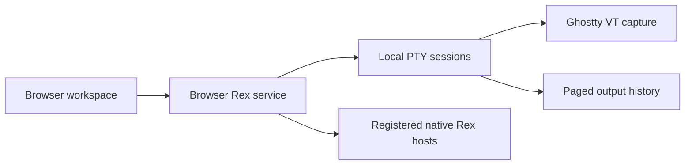

<h1 align="center">Browser Rex</h1>

<p align="center">
  <strong>English</strong> &nbsp; / &nbsp; <a href="README.zh-CN.md">简体中文</a>
</p>

<p align="center"><strong>A self-hosted browser terminal with native Rex host support</strong></p>

<p align="center">Open local shells and existing remote Rex sessions from one workspace. Run it as a single Linux binary with the frontend embedded.</p>

<p align="center">
  
  &nbsp;
  
  &nbsp;
  
</p>

<p align="center">
  <a href="#quick-start"><strong>Get started</strong></a> &nbsp; / &nbsp;
  <a href="docs/usage.md">Configuration &amp; operations</a> &nbsp; / &nbsp;
  <a href="SPEC.md">Protocol support</a> &nbsp; / &nbsp;
  <a href="#verify">Verification</a>
</p>

---

## Quick Start

On Linux, download an AMD64 or ARM64 archive from [Releases](https://github.com/pentaoa/browser-rex/releases), verify it against `SHA256SUMS`, and run `bin/browser-rex` from the extracted directory as an unprivileged account. The default shell sandbox requires Linux user namespaces.

To build from source with Go 1.24+ and Bun:

```sh
make install-dev
make build
bin/browser-rex
```

Open <http://127.0.0.1:8080>. The default service uses a loopback web listener, a private Unix socket, and namespace-isolated shells. See [shell permissions](docs/usage.md#shell-permissions) for system requirements and [remote access](docs/usage.md#remote-access) for exposing the service through SSH or HTTPS.

## Workspace

| Capability | Behavior |
| --- | --- |
| **Sessions** | Keep shells running across browser disconnects. Resume retained output using a byte offset. |
| **Tabs and panes** | Start with vertical tabs or switch to horizontal. Split panes and search or export terminal content. |
| **Hosts** | Manage an owner-controlled host registry and select an existing native Rex server from the workspace. |
| **Input** | Use the browser’s native text input and IME, including in the embedded terminal. |
| **Appearance** | Switch between light, dark, and system appearance from the workspace menu. |
| **Self-hosting** | Run on Linux as an unprivileged user, directly or as a systemd service. |

## How It Works



The PTY publishes output into a bounded set of pages. Live writers and reconnects reference published bytes directly. The workspace waits for a layout or terminal metadata change before reading the full session view. See the [service contract](SPEC.md) for transport and compatibility details.

<details>
<summary>Project structure</summary>

| Directory | Responsibility |
| --- | --- |
| `cmd/browser-rex` | Listeners, HTTP boundaries, and embedded assets |
| `internal/workspace` | Shells, layouts, output streams, and native Rex endpoint |
| `internal/vt` | Authoritative terminal state and capture |
| `internal/remote` | Native Rex host registry and browser adapter |
| `web` | TypeScript workspace, input, and terminal rendering |

</details>

## Verify

```sh
make check race smoke
make browser-smoke
make input-browser layout-browser loading-browser theme-browser
```

`make smoke` requires Linux user namespaces. For packaging see [RELEASING.md](RELEASING.md).

Browser Rex starts from the MIT-licensed [rcarmo/rexweb](https://github.com/rcarmo/rexweb) project. See [LICENSE](LICENSE) and [third-party notices](THIRD_PARTY_NOTICES.md) for the retained licenses and dependency provenance.
